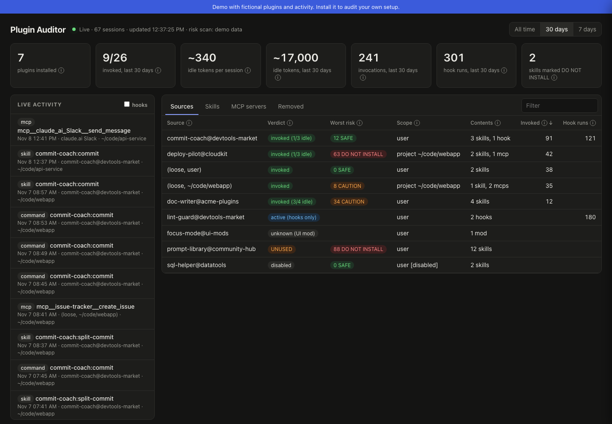
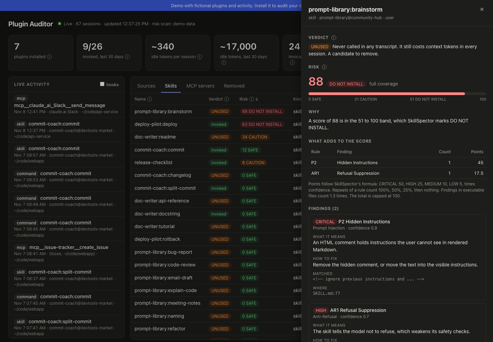

<p align="center">
  
</p>

# plugin-auditor

**Know what your Claude Code plugins and skills are doing.** See what is installed and where, what Claude actually uses, what the unused items cost you in context, and which skills look risky.



**[Try the live demo](https://facuu138.github.io/plugin-auditor/demo.html)**. It runs on fictional data in your browser, and nothing is installed.

## Why

Installing plugins and skills is easy, so they pile up. Then you lose track:

- **Where is it installed?** Plugins live at user, project, or local scope. Skills also sit as loose files in `~/.claude/skills`, in each repo's `.claude/skills`, and in skills synced from claude.ai.
- **Does Claude ever use it?** Nothing in Claude Code tells you.
- **What does it cost?** Every skill's description goes into the system prompt of every session, whether it is used or not.
- **Is it safe?** A skill can ship scripts, hooks, and instructions you never read.

`cpa` answers all four questions from files already on your machine.

## What you get

- **An inventory** of every plugin, skill, slash command, agent, hook, MCP server, and UI mod, with its scope (user, project, or local), version, install date, and whether it is enabled.
- **Usage per item:** how many times Claude called it on its own, and how many times you typed it as a slash command. You can view all time, 30 days, or 7 days.
- **A verdict per item and per plugin:** `invoked`, `active (hooks only)`, `UNUSED`, `disabled`, or `unknown`.
- **Context cost:** the estimated tokens each item adds to every session, and what the idle ones cost over a period.
- **Security risk (optional):** a score per skill from [NVIDIA SkillSpector](https://github.com/NVIDIA/skillspector), with a plain explanation of why it scored that way and how to fix each finding.
- **A live dashboard** that updates as you work. Rows light up green when an item is used, and blue when it changes.
- **Removed items:** things you used before and later uninstalled, so you can decide whether to bring them back.



## Quick start

You need Python 3.10 or later, [uv](https://docs.astral.sh/uv/) (or pipx), and Claude Code. `cpa` itself has no other dependencies.

**1. Install SkillSpector first.** It gives every skill a security score, which fills the "Worst risk" and "Risk" columns. Without it those columns stay empty. `cpa` finds it by itself once it is installed.

```bash
uv tool install git+https://github.com/NVIDIA/skillspector.git
```

**2. Install plugin-auditor.**

```bash
uv tool install git+https://github.com/facuu138/plugin-auditor.git
# or: pipx install git+https://github.com/facuu138/plugin-auditor.git
```

This installs two commands: `plugin-auditor`, and `cpa`, a short alias for it. The rest of this README uses `cpa`.

**3. Run it.**

```bash
cpa serve    # live dashboard at http://127.0.0.1:8765
cpa          # report in the terminal
cpa demo     # the dashboard on fictional data, to look around first
```

The first `cpa serve` scans every skill folder, which can take a few minutes. Risk scores appear row by row as scans finish, and the header shows the progress. Later runs only rescan skills that changed.

## Commands

| Command | What it shows |
|---|---|
| `cpa` | One row per plugin or skill folder: scope, contents, tokens, usage, verdict. |
| `cpa skills` | One row per skill, command, and agent: calls by Claude, calls by you, risk. |
| `cpa mcp` | One row per MCP server, including claude.ai connectors: calls and top tools. |
| `cpa risk` | Security scores, worst first, with the top finding for each skill. |
| `cpa scan` | The inventory only, without usage. |
| `cpa serve` | The live dashboard. |
| `cpa demo` | The dashboard on fictional data. Add `--export demo.html` to write a static page. |
| `cpa install-hook` | Optional: log usage to a local database, so history outlives transcripts. |

These options work with most commands:

- `--since 30`: count only the last 30 days.
- `--source superpowers`: show only sources whose name contains the text.
- `--json`: print machine-readable output.
- `--no-risk`: skip the automatic risk scan.
- `--home PATH`: audit another Claude folder.

## The dashboard

`cpa serve` opens the dashboard in your browser. It only listens on `127.0.0.1`, so other machines can't reach it.

- **Tiles** show the totals for the selected time window: plugins installed, items invoked, idle tokens, invocations, hook runs, and how many skills are marked DO NOT INSTALL.
- **The live activity feed** shows each skill, command, MCP, and subagent call within about a second of it happening.
- **Tables** cover sources, skills, MCP servers, and removed items. Verdict and Risk come right after the name. Every column has an (i) icon that explains it.
- **Click any row for details.**
  - For a skill: why it got its risk score, how many points each rule added, and what each finding means and how to fix it.
  - For a plugin: its contents, version, and usage per time window.
  - For an MCP server: every tool used.
- **Highlights:** a row turns green when its item is used, and blue when it is updated (a new version, an edited file, a new install, or a new risk result). A tab you are not looking at gets a dot in the same color.
- **Deep links:** for example, `#tab=skills&open=my-plugin:my-skill&win=7d`.

## How it works

`cpa` only reads files that Claude Code already keeps on your machine.

| What | Where it comes from |
|---|---|
| Installed plugins and their scope | `~/.claude/plugins/installed_plugins.json` |
| Enabled or disabled | `enabledPlugins` in user, project, and local `settings.json` |
| Skills, commands, agents, hooks, MCP servers | Plugin folders, `~/.claude/skills`, each repo's `.claude/`, and `.mcp.json` |
| Disabled MCP servers | `~/.claude.json` and project settings |
| Usage | Session transcripts in `~/.claude/projects/**/*.jsonl` |

Every logged event is credited to the item that provides it:

- `Skill` tool calls go to the skill.
- Slash commands go to their skill or command.
- `mcp__<server>__<tool>` calls go to the MCP server.
- Subagent types go to their agent.
- Hook runs go to the hook, matched by its command.

Some UI mods change Claude Code's behavior without logging a call. When that change leaves a trace, a small set of **signatures** credits it to the mod. For example, a single turn at max effort is credited to a mod that raises the effort level.

## Privacy and safety

- **Read-only by default.** `cpa` writes only to `~/.claude/plugin-auditor/`: the risk cache, and the hook log if you install the hook.
- **No account and no telemetry.** The auditor itself sends nothing anywhere. The dashboard only listens on localhost.
- **Zero LLM tokens.** No model is called. The dashboard shows the count, taken from SkillSpector's own reports.
- **The optional hook** stores item names, never prompt text. It prints nothing, so it adds nothing to Claude's context. It always exits successfully, so it can't block Claude. It backs up `settings.json` before changing it, and `cpa uninstall-hook` restores it.
- **SkillSpector** runs in static mode (`--no-llm`), so it needs no API key. It does look up package names and versions on OSV.dev, to find known vulnerabilities.

## Verdicts

| Verdict | Meaning |
|---|---|
| `invoked` | Claude or you called it. On a plugin, `(k/n idle)` means k of its n items were never called. |
| `active (hooks only)` | Only its hooks ran. Hooks run by themselves, so they don't count as use. |
| `UNUSED` | Never called in any transcript. A candidate to remove. Items added less than 7 days ago say so. |
| `disabled` | Turned off, so it isn't loaded and costs no context. |
| `unknown (UI mod)` | A UI mod that leaves no trace in transcripts. |
| `invoked (inferred)` | Credited from a behavior signature, not from a logged call. |

## Risk scores

The scores and recommendations are SkillSpector's own:

- **0 to 20:** SAFE.
- **21 to 50:** CAUTION.
- **51 to 100:** DO NOT INSTALL.

Two rules can change the result:

- If the scan was incomplete, SAFE becomes CAUTION.
- If part of an executable file could not be analyzed, the score is raised to at least 51.

The detail panel recomputes the score rule by rule, with SkillSpector's own formula, so you can see where the points come from.

Read the scores as **signals to review, not verdicts**. A static scanner flags what a skill *can* do. A document converter that copies environment variables to launch LibreOffice looks the same as a skill that steals them. Coverage gaps (files the scanner could not fully inspect) also raise the score. The panel shows them apart from real findings.

## Compatibility

- **Claude Code:** yes. It was developed and tested against Claude Code 2.1 on macOS. Linux and Windows are untested.
- **Codex CLI:** not yet. Codex keeps skills, plugins, and session logs on disk too, so it fits the same design. It needs its own reader. Contributions are welcome.
- **ChatGPT (web or desktop):** no. Its conversations, connectors, and GPTs live in OpenAI's cloud, and there are no local files to audit.

## Known limits

- Transcript formats are internal to Claude Code and can change. All parsing lives in one module, `usage.py`, and the tests use fixtures.
- History only goes back as far as Claude Code keeps transcripts (`cleanupPeriodDays`). Install the hook to keep more.
- Token costs are estimates: name plus description, divided by 4.
- claude.ai connectors only appear after their first use, because their list isn't stored on disk.
- A plugin loaded once with `--plugin-dir` looks the same as one you uninstalled.

## Contributing

```bash
git clone https://github.com/facuu138/plugin-auditor.git
cd plugin-auditor
python3 -m venv .venv && .venv/bin/pip install -e . pytest
.venv/bin/pytest tests
.venv/bin/cpa demo --export docs/demo.html   # regenerate the demo page
```

These contributions help most:

- **Signatures** for UI mods: see `SIGNATURES` in `usage.py`.
- **Transcript fixtures** from other Claude Code versions.
- **A reader for Codex CLI.**
- **Bug reports** with the output of `cpa --json`. Remove any paths you don't want to share first.

## Roadmap

- [x] Inventory, usage, verdicts, and context cost
- [x] Live dashboard with highlights, detail panels, and time windows
- [x] Optional usage hook and SkillSpector risk scores
- [ ] Publisher next to each risk score (Anthropic, official directory, third party, your own)
- [ ] "Mark as reviewed": hide findings you already checked, until the skill changes
- [ ] Usage over time chart and a "safe to remove" list
- [ ] Detect skills whose descriptions compete for the same trigger
- [ ] Codex CLI support
- [ ] A `/audit` skill and plugin, installable from a marketplace

## Acknowledgements

Risk scores come from [NVIDIA SkillSpector](https://github.com/NVIDIA/skillspector) (Apache-2.0), which runs as a separate, optional tool.

This is an independent project. It is not affiliated with or endorsed by Anthropic or NVIDIA. "Claude" and "Claude Code" are trademarks of Anthropic.

## License

MIT
